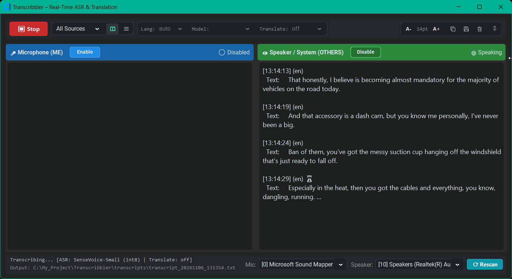

# Transcribbler

```text
╭─────────────────────────────────────────────────────────────────────────────────────╮
│                                                                                     │
│   _____ ____      _    _   _ ____   ____ ____  ___ ____  ____  _     _____ ____     │
│  |_   _|  _ \    / \  | \ | / ___| / ___|  _ \|_ _| __ )| __ )| |   | ____|  _ \    │
│    | | | |_) |  / _ \ |  \| \___ \| |   | |_) || ||  _ \|  _ \| |   |  _| | |_) |   │
│    | | |  _ <  / ___ \| |\  |___) | |___|  _ < | || |_) | |_) | |___| |___|  _ <    │
│    |_| |_| \_\/_/   \_\_| \_|____/ \____|_| \_\___|____/|____/|_____|_____|_| \_\   │
│                                                                                     │
│                             "It listens, it scribbles."                             │
│  ─────────────────────────────────────────────────────────────────────────────────  │
│                                                                                     │
│      (o)  ME     ~~~  .||.|||.||.  ~~~>   ┌──────────────┬───────────────────┐      │
│      /|\              '||'|||'||'         │ ME           │ OTHERS            │      │
│                       (WASAPI)            │ > Hello...   │ > Ni hao!         │      │
│      [=]  OTHERS ~~~  .||.|||.||.  ~~~>   │   [en]       │   [zh -> en]      │      │
│                                           └──────────────┴───────────────────┘      │
│                                                                                     │
╰─────────────────────────────────────────────────────────────────────────────────────╯
```

> *It listens, it scribbles.*  
> Real-time multilingual speech-to-text on Windows (CPU-only, no NVIDIA GPU required) capturing both your **microphone** and **system audio / speakers** (via WASAPI loopback) with live translation, romanization, and a modern desktop interface.

---


[](#license)
-success)

## Features

- ⚡ **Near-Real-Time Streaming Transcription**:
  - Upgraded from delayed batch chunking to **low-latency streaming recognition (1.5–2.5s target latency)**.
  - Emits live interim snapshots with visual indicator badges (`⏳ ...`) updated in-place every 1.5 seconds, with **interim text deduplication** and **final-utterance priority** so completed sentences never wait behind interim previews.
  - **Drop-stale interim backpressure & bounded audio queues**: Asynchronous single-slot interim buffering and bounded PortAudio capture queues (`maxsize=256`) prevent queue buildup and ensure the pipeline never falls behind real time.
  - **Adaptive Clause Splitting, Lowest-RMS Carry-Over & Lossless Decimation**: Adaptive micro-pause detection splits long speech naturally at clause boundaries; continuous non-stop speech (up to 12s) splits at the lowest-energy syllable boundary with frame context carry-over and remainder-preserving 48 kHz → 16 kHz decimation to avoid cutting words or dropping samples.
- 🚀 **Optimized Startup & Low-Overhead Runtime**:
  - **Non-Blocking Async Model Loading**: Starts ASR and translation engines on a background thread so the desktop UI stays smooth and responsive while loading models.
  - **Lazy Romanizer Initialization & LRU Caching**: Defers `pycantonese` and `pypinyin` corpus loading until Chinese/Cantonese speech is detected (cutting cold startup time by ~40%) and caches romanization and offline translation lookups.
  - **Persistent Cloud Sessions & Diff-Guarded UI**: Reuses HTTP keep-alive TLS connections for Azure/Google translation, skips off-screen hidden view updates, and uses lock-free timestamp tracking for 20 Hz VAD activity LEDs.
- 🎙️ **Dual-Channel Audio Capture**:
  - **Microphone (`ME`)**: Captures your local microphone voice.
  - **System Loopback (`OTHERS`)**: Directly captures speaker and headset audio (meetings, Zoom, Teams, YouTube, browser calls) without requiring virtual audio cables.
- 🌐 **Language-Driven Dual-Engine ASR Selector (`sherpa-onnx`, INT8 CPU)**:
  - **`Lang = auto` (Multilingual / Cantonese / Mandarin)**: Loads **SenseVoice-Small (INT8)** via `OfflineRecognizer.from_sense_voice(use_itn=True)` for instantaneous trilingual switching (`en`, `zh`, `yue`), `<|yue|>` tag detection, and full compatibility with local Pinyin / Jyutping romanization.
  - **`Lang = en` (English Meetings & Podcasts)**: Dynamically routes to **NeMo Parakeet-TDT-0.6B-v2 (INT8)** (`OfflineRecognizer.from_transducer(model_type="nemo_transducer")`) as the primary engine—with automatic fallback to **Moonshine-Base-EN (INT8)** (`OfflineRecognizer.from_moonshine`) for ultra-low-end PCs—delivering near-instantaneous CPU decoding with top-tier conversational English accuracy, native capitalization, and punctuation. You can also explicitly pick **`auto`**, **`parakeet`**, or **`moonshine`** right from the GUI's **`Model:`** dropdown (or via `--en-engine` in CLI).
- 🔤 **Automatic Romanization**:
  - **Mandarin**: Tone-marked Pinyin (via `pypinyin`).
  - **Cantonese**: Accurate Jyutping romanization (via `pycantonese`).
- 🌍 **Translation Options**:
  - **Off**: Fast transcription & romanization only. Completely suppresses redundant `EN:` translation lines for cleaner output.
  - **Offline (Argos Translate + OpenCC)**: 100% private, on-device translation from Chinese to English with zero network requests.
  - **Cloud (Azure Translator / Google Cloud Translation)**: Dedicated high-quality Cantonese (`yue`) and Mandarin (`zh`) translation to English.
- 🖥️ **Modern Desktop GUI (CustomTkinter)**:
  - **Dual-Column Split View (Default)**: Dedicated side-by-side feed with `ME` on the left and `OTHERS` on the right.
  - **Live Channel Capture Toggles**: Dedicated **`[Disable]` / `[Enable]`** pills on both `Microphone (ME)` and `Speaker / System (OTHERS)` to instantly pause and resume audio capturing on either channel in real time while preserving each channel's color-coded header identity.
  - **Grouped Top Control Bar Clusters**:
    - **Audio & View Cluster**: Combines the compact source filter dropdown (**All Sources**, **Mic Only**, **Speaker Only**) and the one-click segmented view icon toggle (`◫` **Dual Column** / `☰` **Unified Timeline** with hover tooltips) into a unified pill.
    - **Speech Pipeline Cluster**: Houses **`Lang:`** (`auto` | `en`), **`Model:`** (`auto` | `parakeet` | `moonshine`, unlocked when `Lang = en`), and **`Translate:`** (`off` | `offline` | `azure` | `google`) with `Consolas` labels and vertical dividers.
    - **Document Utilities, Font Scaler & Pin Cluster**: Houses compact font size scaling (`A-` / `14pt` / `A+`), crisp vector icon buttons for **Copy Transcript**, **Save Transcript**, and **Clear Session** (with red hover), and a **Pin (Always on Top)** icon toggle with an active teal indicator dot.
  - **Two-Line Bottom Status Bar & Pinned Device Controls**:
    - **Left Two-Line Readout**: Displays the active session/ASR/translation status on Line 1 (`Transcribing... [ASR: ... | Translate: ...]`) and the transcript file path on Line 2 (`Output: ...`, with a full-path hover tooltip).
    - **Right Pinned Device Controls**: Keeps the **`Mic:`** and **`Speaker:`** selectors and the **`⟳ Rescan`** button permanently visible on the right regardless of status text or path length.
  - **Live VAD Activity LEDs**: Pulsing visual indicators when speech is actively detected on either channel, backed by an auto-reset watchdog for silent audio streams.
  - **Hot-Plug Device Detection**: Plug in or unplug USB / Bluetooth headphones and the **Mic** / **Speaker** lists update automatically (or click **⟳ Rescan** to rescan on demand — hover it for a tooltip) — no restart needed. You can switch devices live mid-session without reloading the speech model.
- 💻 **Headless CLI Mode**: Full-featured command-line interface preserving complete terminal compatibility, automated piping support, and graceful `Ctrl+C` interrupt handling in PowerShell.

---

## Project Structure

```
Transcribbler/
├── models/
│   ├── sherpa-onnx-sense-voice-zh-en-ja-ko-yue-int8-2024-07-17/
│   │   ├── model.int8.onnx
│   │   └── tokens.txt
│   ├── sherpa-onnx-nemo-parakeet-tdt-0.6b-v2-int8/          # Primary English engine (Lang=en)
│   │   ├── encoder.int8.onnx
│   │   ├── decoder.int8.onnx
│   │   ├── joiner.int8.onnx
│   │   └── tokens.txt
│   └── sherpa-onnx-moonshine-base-en-int8/                  # Optional lightweight English fallback
│       ├── preprocess.onnx
│       ├── encode.int8.onnx
│       ├── uncached_decode.int8.onnx
│       ├── cached_decode.int8.onnx
│       └── tokens.txt
├── transcripts/                               # Auto-created transcript output directory
├── transcribbler/
│   ├── __init__.py                            # Single source of truth for __version__ ("1.0.0")
│   ├── config.py                              # Version/title constants, audio settings, paths
│   ├── core/
│   │   ├── __init__.py
│   │   ├── events.py                          # Utterance, TranscriptEntry, AudioStatusEvent
│   │   ├── audio.py                           # Resampler, VAD Segmenter, Capture, Device helpers
│   │   ├── engine.py                          # SenseVoice Recognizer, Romanizers, Translators
│   │   └── session.py                         # TranscriptionSession (threads, queue, safe cleanup)
│   ├── ui/
│   │   ├── __init__.py
│   │   ├── styles.py                          # Design tokens, dark mode colors, fonts
│   │   ├── components.py                      # Utterance formatting and helpers
│   │   └── app.py                             # TranscribblerApp (CustomTkinter UI)
│   └── cli.py                                 # Headless CLI entrypoint (with signal handling)
├── main.py                                    # Master entrypoint (GUI default or --cli)
├── requirements.txt
├── .gitignore
└── README.md
```

---

## Prerequisites & Installation

### 1. Requirements

- **Operating System**: Windows 10 / 11 (64-bit)
- **Python**: Python 3.10 to 3.13 (64-bit)
- **Audio**: Standard microphone and speaker/headset (WASAPI-compatible)

### 2. Environment Setup

Clone or open the repository in PowerShell:

```powershell
git clone https://github.com/JsonHide/Transcribbler.git
cd Transcribbler

# Optional: Create and activate a virtual environment
py -3.12 -m venv .venv
.venv\Scripts\activate

# Install required dependencies
pip install -r requirements.txt
```

> [!TIP]
> On a fresh Windows machine, if PowerShell blocks `.venv\Scripts\activate` due to execution policy, run:
> ```powershell
> Set-ExecutionPolicy -Scope CurrentUser RemoteSigned
> ```

> [!NOTE]
> `argostranslate` is already included in `requirements.txt`. If you plan to use the on-device offline translation backend, download the Chinese-to-English (`zh -> en`) language pack once via:
> ```powershell
> python main.py --cli --install-offline-pack
> ```

### 3. Download Speech Models (One-Time)

#### A. Multilingual Engine (`Lang = auto`: English, Cantonese, Mandarin — SenseVoice-Small INT8, ~230 MB)
```powershell
New-Item -ItemType Directory -Force -Path models | Out-Null
cd models
curl.exe -L -O https://github.com/k2-fsa/sherpa-onnx/releases/download/asr-models/sherpa-onnx-sense-voice-zh-en-ja-ko-yue-int8-2024-07-17.tar.bz2
tar -xf sherpa-onnx-sense-voice-zh-en-ja-ko-yue-int8-2024-07-17.tar.bz2
rm sherpa-onnx-sense-voice-zh-en-ja-ko-yue-int8-2024-07-17.tar.bz2
cd ..
```

#### B. Primary English Engine (`Lang = en`: Meetings & Podcasts — NeMo Parakeet-TDT-0.6B-v2 INT8)
```powershell
New-Item -ItemType Directory -Force -Path models | Out-Null
cd models
curl.exe -L -O https://github.com/k2-fsa/sherpa-onnx/releases/download/asr-models/sherpa-onnx-nemo-parakeet-tdt-0.6b-v2-int8.tar.bz2
tar -xf sherpa-onnx-nemo-parakeet-tdt-0.6b-v2-int8.tar.bz2
rm sherpa-onnx-nemo-parakeet-tdt-0.6b-v2-int8.tar.bz2
cd ..
```

#### C. Optional Ultra-Low-End PC English Fallback (`Lang = en`: Moonshine-Base-EN INT8)
```powershell
New-Item -ItemType Directory -Force -Path models | Out-Null
cd models
curl.exe -L -O https://github.com/k2-fsa/sherpa-onnx/releases/download/asr-models/sherpa-onnx-moonshine-base-en-int8.tar.bz2
tar -xf sherpa-onnx-moonshine-base-en-int8.tar.bz2
rm sherpa-onnx-moonshine-base-en-int8.tar.bz2
cd ..
```

---

## Quick Start

### 1. Launching Desktop GUI (Default)

Simply run:

```powershell
python main.py
```

- **Start Capture**: Click **▶ Start** to begin listening to your mic and system audio.
- **Select Language & English ASR Engine (`Lang:` & `Model:`)**: Choose **`auto`** for multilingual SenseVoice-Small (English, Cantonese, Mandarin with Pinyin/Jyutping) or **`en`** for dedicated English meetings and podcasts. Selecting **`en`** unlocks the **`Model:`** dropdown where you can choose **`auto`** (Parakeet with Moonshine fallback), **`parakeet`** (NeMo Parakeet-TDT-0.6B-v2), or **`moonshine`** (Moonshine-Base-EN). The active ASR engine is displayed in the bottom status bar.
- **Channel Mute / Pause**: Click **`[Disable]`** or **`[Enable]`** directly in either the `Microphone (ME)` or `Speaker / System (OTHERS)` header to pause or resume capturing that channel live without stopping the session.
- **Switch Views & Filter Sources**: Inside the left **Audio & View Cluster**, pick **All Sources**, **Mic Only**, or **Speaker Only** from the filter dropdown, or click the segmented view icon toggle (`◫` on the left for **Dual Column**, `☰` on the right for **Unified Timeline**; hover either icon for a tooltip).
- **Refresh / Switch Audio Devices & Two-Line Status Bar**: The bottom bar shows live engine/translation telemetry on Line 1 and the active `Output:` file path on Line 2 (with a hover tooltip for the full path), while pinning the **Mic:** / **Speaker:** dropdowns and **⟳ Rescan** button on the right so they are always accessible. Newly connected USB or Bluetooth headsets appear automatically within ~3 seconds, and you can switch devices live mid-session without stopping transcription.
- **Font Scaling, Export & Float Over Apps**: In the right utility cluster, use **`A-`** / **`A+`** to adjust transcript font size, click the **Copy**, **Save**, or **Clear** icon buttons (with hover tooltips), or click the **Pin (Always on Top)** icon button to keep Transcribbler floating beside Zoom, Teams, Google Meet, or video players.

### 2. Headless CLI Mode

For automated pipelines, scripts, or terminal workflows:

```powershell
# Interactive startup (prompts for translation backend)
python main.py --cli

# List available audio devices and WASAPI loopback endpoints
python main.py --cli --list-devices

# Meeting transcription (speakers only, forced Cantonese, Azure translation)
python main.py --cli --no-mic --language yue --translator azure --output-mode translate

# Dedicated English meeting/podcast mode (uses Parakeet-TDT-0.6B-v2 or Moonshine fallback)
python main.py --cli --language en --translator off

# Offline-only mode (zero telemetry/cloud usage)
python main.py --cli --translator offline

# Specify custom audio device indices and transcript path
python main.py --cli --mic-device 1 --speaker-device 10 --out transcripts/meeting_notes.txt
```

> [!TIP]
> Press **`Ctrl+C`** at any time to gracefully drain pending transcriptions and stop the CLI.

#### Available CLI Options:
```
  --version                                    Show program's version number (v1.0.0) and exit
  --translator {ask,offline,azure,google,off}  Translation backend (default: ask)
  --language {auto,en,zh,yue}                  Recognition language: 'auto' (SenseVoice) or 'en' (Parakeet/Moonshine)
  --en-engine {auto,parakeet,moonshine}        Preferred English engine when --language=en (default: auto)
  --output-mode {original,roman,translate,all} Fields to output (default: all)
  --threads THREADS                            CPU threads for ONNX ASR (default: 4)
  --no-mic                                     Disable microphone capture
  --no-speaker                                 Disable system loopback capture
  --mic-device MIC_DEVICE                      Input device index for microphone
  --speaker-device SPEAKER_DEVICE              WASAPI loopback device index for speakers
  --list-devices                               List audio devices and exit
  --install-offline-pack                       Download Argos zh->en package and exit
  --out OUT                                    Custom output text file path
```

---

## Cloud Translation Setup (Optional)

If using cloud translation, set the required environment variables and **open a new PowerShell window** so they take effect:

- **Azure Translator**:
  ```powershell
  setx AZURE_TRANSLATOR_KEY "your-azure-key"
  setx AZURE_TRANSLATOR_REGION "eastasia"   # or "global"
  ```
- **Google Cloud Translation (Basic v2)**:
  ```powershell
  setx GOOGLE_TRANSLATE_API_KEY "your-google-api-key"
  ```

---

## Output Format

Transcripts are written to both the interface and `transcripts/transcript_YYYYMMDD_HHMMSS.txt`:

```text
[14:02:11] [ME] (yue)
  Text:     唔該大家睇睇今日個報告
  Jyutping: m4 goi1 daai6 gaa1 tai2 tai2 gam1 jat6 go3 bou3 gou3
  EN:       Please everyone take a look at today's report.

[14:02:15] [OTHERS] (en)
  Text:     Sure, let me share the slide deck on my screen.

[14:02:28] [OTHERS] (zh)
  Text:     好的，我们现在开始讨论第二项议题
  Pinyin:   hǎo de, wǒ men xiàn zài kāi shǐ tǎo lùn dì èr xiàng yì tí
  EN:       Alright, let's now discuss the second agenda item.
```

*(Note: When Translation is set to `off`, the `EN:` translation lines are completely omitted for cleaner transcripts).*

---

## Release Highlights

- **3-Phase Stability-First Performance Optimization & Centralized `v1.0.0` Versioning (v1.0.0)**:
  - **Phase 1 — GUI Responsiveness & Fast Startup**: Moved ONNX model loading and session initialization off the Tkinter main thread to a background startup worker so the GUI never freezes on `▶ Start`. Lazy-loaded `pycantonese` and `pypinyin` corpora on first Chinese/Cantonese detection (cutting cold startup time by ~40%), skipped hidden `Unified Timeline` widget updates while in `Dual Column` mode, and replaced high-frequency VAD activity queue flooding with monotonic timestamp tracking and state-diff guards.
  - **Phase 2 — ASR Worker, Romanization & Translation Efficiency**: Added LRU caching on `romanize()` (`maxsize=256`) and `OfflineTranslator.translate()` (`maxsize=128`), pre-compiled language/CJK regexes, switched `AzureTranslator` and `GoogleTranslator` to persistent `requests.Session()` HTTP keep-alive connections, prioritized final utterances (`self.q.empty()`) ahead of interim previews, and deduplicated unchanged interim texts.
  - **Phase 3 — Audio & VAD Hot-Path Refinements**: Preserved integer decimation remainder samples across audio callbacks in `AudioResampler` for zero sample drift on 48 kHz → 16 kHz downsampling, converted `Segmenter.feed()` to cursor-based indexing with cached `(frame, rms)` pre-buffer tuples and `np.dot()` RMS math, bounded `Capture.raw_queue` (`maxsize=256`) with non-blocking drop-oldest fallback, and hoisted WinMM `ctypes` structures to module scope.
  - **Version Single Source of Truth**: Centralized `__version__ = "1.0.0"` in `transcribbler/__init__.py` with derived `APP_VERSION` and `APP_TITLE` in `transcribbler/config.py`, updated the desktop window title bar to `Transcribbler – Real-Time ASR & Translation – v1.0.0`, and added `--version` to the CLI.
- **Stitch-Synced Grouped Top Control Bar, Vector Utility Icons & Two-Line Status Bar (v0.9.0)**: Reorganized the top toolbar into bordered control clusters (**Audio & View Cluster**, **Speech Pipeline Cluster** with `Lang:` | `Model:` | `Translate:`, and **Document Utilities, Compact Font Scaler & Pin Cluster** with `A-` / `14pt` / `A+` plus crisp vector icon buttons for **Copy**, **Save**, **Clear**, and **Always on Top** Pin toggle) so all controls fit cleanly on a single row. Upgraded the bottom bar to a **two-line status readout** (Line 1: engine/translation/device status; Line 2: `Output:` transcript path with hover tooltip) while pinning the right-side **Mic**, **Speaker**, and **⟳ Rescan** controls so they always remain visible. Refined channel header `[Disable]` / `[Enable]` pills to preserve channel color identity when paused.
- **GUI English Model Selector & Segmented View Toggle (v0.8.0)**: Added an **`EN Model:`** dropdown (`auto` | `parakeet` | `moonshine`) next to `Lang:` that unlocks when `Lang = en`, and replaced the `View:` dropdown with a compact segmented icon toggle (`◫` Dual Column / `☰` Unified Timeline) with hover tooltips.
- **Language-Driven Dual-Engine ASR Selector (v0.7.0)**: Added a **`Lang:`** dropdown (`auto` | `en`) in the GUI top bar and upgraded `--language` in the CLI to dynamically route between **SenseVoice-Small (INT8)** for multilingual Cantonese/Mandarin/English (`auto`) and **NeMo Parakeet-TDT-0.6B-v2 (INT8)** (with **Moonshine-Base-EN INT8** fallback) for high-accuracy conversational English (`en`) with native capitalization and punctuation.
- **Dynamic Audio Device Refresh (v0.6.0)**: Added a teal **⟳ Rescan** button (with hover tooltip and scanning state) and automatic USB / Bluetooth hot-plug detection for the Mic and Speaker lists, plus live device switching during a session (only the audio streams are recycled; the SenseVoice model, worker, and transcript file stay running).
- **Near-Real-Time Streaming Transcription (v0.5.0)**: Upgraded from 25-second delayed batch chunking to streaming transcription with 1.5–2.5s responsiveness. Features in-place GUI interim text replacement (`⏳ ...`), drop-stale interim backpressure preventing worker backlog, two-tier adaptive clause segmentation, and lowest-RMS syllable splitting with frame carry-over to eliminate mid-word cuts.
- **Channel Capture Toggles (v0.4.0)**: Added live **`[Disable]` / `[Enable]`** buttons in the Microphone and Speaker headers to pause and resume audio capturing independently at the hardware/audio callback level.
- **Graceful CLI Shutdown (v0.3.0)**: Fixed PowerShell `Ctrl+C` interruption by converting the uninterruptible wait into a periodic polling loop and adding Windows `SIGBREAK` signal mapping.
- **Cleaner Transcripts when Translation is Off (v0.2.0)**: Suppressed redundant `EN:` duplicate lines when Translate is set to `off`.
- **Repository Optimization (v0.3.0)**: Streamlined git repository by excluding internal implementation markdowns via `.gitignore`.
- **Desktop UI Enhancements (v0.1.0)**: Added Dual-Column view, Unified Timeline view, dynamic font scaling, copy/save transcript buttons, and live VAD indicators with idle auto-reset.

---

## Practical Tips

1. **Headset Recommendation**: When capturing both microphone and speaker audio simultaneously, wear a headset to avoid external speaker audio bleeding into your microphone.
2. **WASAPI Loopback Behavior**: Windows stops sending loopback frames when no application is emitting sound. Transcribbler handles this gracefully with an automatic VAD activity watchdog.
3. **Bluetooth Headsets**: If using a Bluetooth headset, verify sample rates with `python main.py --cli --list-devices` and select the appropriate interface from the GUI dropdown or CLI flag. In the GUI, a newly paired headset shows up automatically; if it doesn't, click **⟳ Rescan**.

---

## License

MIT License. See individual model licenses in `models/` for SenseVoice usage terms.
